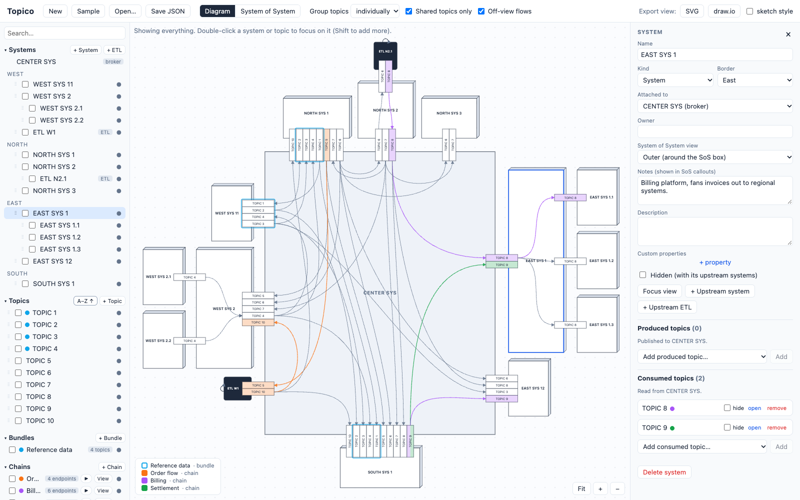
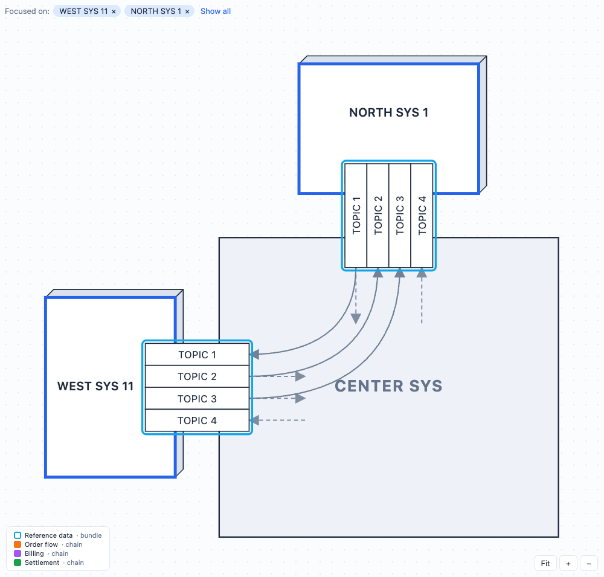
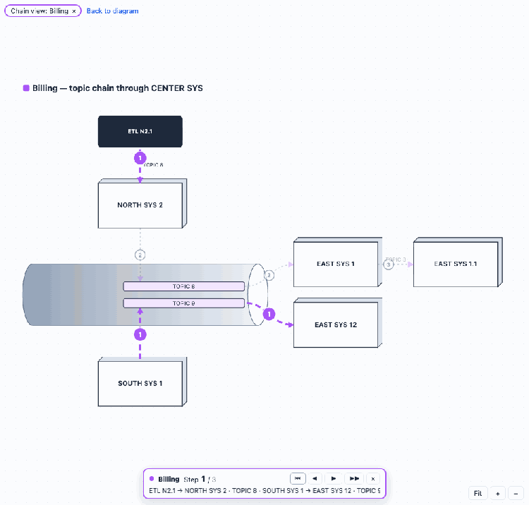
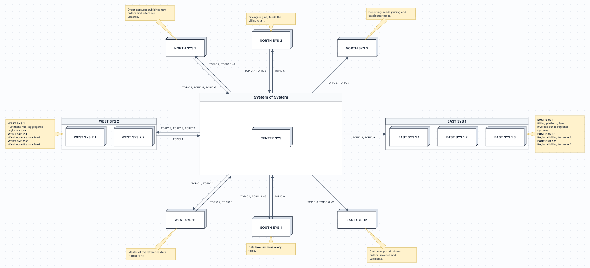

# Topico

**Draw who publishes and who reads each topic around your message broker, then explore it from every angle.**

Topico places your systems around a central broker, draws the topics they exchange, and keeps the diagram readable as you focus, group, hide or animate parts of it. Everything runs in the browser: no server, no account.

[](https://github.com/scodeman/topico/actions/workflows/pages.yml)
[](https://scodeman.github.io/Topico/)
[](https://github.com/scodeman/topico/commits/master)
[](.github/dependabot.yml)
[](LICENSE)

[](https://www.typescriptlang.org/)
[](https://react.dev/)
[](https://vite.dev/)
[](https://vitest.dev/)

### ▶ [Open the app](https://scodeman.github.io/Topico/)

It starts with a sample landscape you can play with straight away.

[](https://scodeman.github.io/Topico/)

## A quick tour

### Focus on what matters
Double-click a system or a topic, or tick it in the left panel, to keep only what relates to it. The layout shrinks to fit. Dashed arrows show flows that continue outside the focus.



### Follow a chain and replay it step by step
Group the endpoints of a business flow into a **chain**, number its links in a **sequence**, and press ▶. The chain lights up step by step, on the diagram or in its **tube view**, where the broker is drawn as a pipe.



### See the System of System
Switch the toolbar from **Topics** to **System of System**. Inner systems sit in a central box and outer systems surround it like petals, each with its notes. Arrows list the topics that go in and out.

[](https://scodeman.github.io/Topico/)

### Take it with you
Export any view, including a focused view, the chain tube or the SoS view, to **SVG** or **draw.io**. While a chain is animating, the draw.io file has one page per step, with draw.io's own flow animation.

## Run it locally

```bash
npm install
npm run dev        # http://localhost:5173
npm test           # engine tests (filtering, grouping, layouts, sequences)
npm run build
```

Requirements, their status and the design decisions are tracked in [docs/spec/SPEC.md](docs/spec/SPEC.md). The original sketches are in [docs/spec/images](docs/spec/images).

## Model

| Element | Notes |
|---|---|
| **Centre** | The broker. Always drawn in the middle. |
| **System** / **ETL** | An ETL is a processing job (**E**xtraction, **T**ransformation and **L**oading of topics), drawn as a small dark box. Both are attached to a centre border (West, North, East, South), or *upstream* of another system, in which case it sits on that system's outer border in the same direction. |
| **Topic** | Drawn as a tab on the border between a system and its parent. |
| **Interaction** | A system *produces* or *consumes* a topic. The direction is always relative to the system's parent (the broker, or the upstream system it hangs off). |
| **Bundle** | A named group of whole topics. It is drawn as an outline around adjacent tabs. |
| **Chain** (topic chain) | A named group of individual endpoints (this system producing or consuming this topic). The same topic can be in a chain at one system and outside it at another, and an endpoint can be in several chains. The chain colours its endpoint tabs (striped when an endpoint is in several chains), and colours the arrows that link two of its endpoints. |

Arrows are derived automatically. Inside each container (the broker or a system), every producer of a topic points to every consumer of that topic. A system relays a topic to its upstream systems: what it consumes from the broker it passes to its children, and the reverse.

The model is saved automatically in the browser (localStorage). Use **Save JSON** and **Open…** to keep files.

## How to

- **Click** a system, topic or the broker to edit it in the right pane. The system pane lists its produced and consumed topics, each with editable details.
- **Double-click** a system or topic to focus the view on it. **Shift+double-click** adds more. You can also use the checkboxes in the left panel.
  - One system: its topics, its upstream leaves and the ETLs on the broker it exchanges with.
  - Several systems: only the topics they exchange (turn off *Shared only* to see all of their topics).
  - Topics: only the systems that produce or consume them.
  - The broker, or **Show all**: everything.
- Dashed arrows (*Off-view flows*) show that a topic also flows to or from systems outside the current focus.
- Both side panels have a handle next to the canvas: drag it to resize the panel, double-click it to reset the width, and use ‹ / › to collapse or show the panel.
- **Drag a system on the diagram** to reorder it, move it to another border or attach it to another parent. It follows the same rules as dragging it in the left panel, which updates by itself. Escape cancels.
- In the left panel:
  - Drag a system by its ⋮⋮ handle. Drop it above or below another row to reorder, on a border heading to move it to that border, or on the middle of a row to make it upstream of that system. The canvas follows the order in the left panel.
  - Topics: drag topics to reorder them. The sort button in the section header shows ↑ (A–Z), ↓ (Z–A) or ↕ (custom order). Click it to sort A–Z, or Z–A when the list is already A–Z.
  - Fold a parent's upstream systems with its ▾ chevron, or a whole border with the chevron on its heading. ⊟ and ⊞ on a border fold or unfold all of its rows, and **+** adds a system on that border.
  - Bundles and Chains have the same ↑ / ↓ sort button as Topics, and can also be dragged into your own order.
  - Double-click any item to rename it.
  - Right-click any item for Rename, Duplicate and Delete. On a system, **+ System** and **+ ETL** add one upstream of it.
- On a bundle or chain, ● / ◌ (or a click on it in the canvas legend) hides or shows its colouring only. Its topics and flows stay, drawn in the default style.
- ● / ◌ hides or shows a system (with its upstream systems) or a topic. Single interactions can be hidden from the system or topic pane.
- **System of System view**: switch the toolbar from **Topics** to **System of System** to see the inner systems in a central box and the outer systems around it like petals, each with a note callout and arrows listing the topics exchanged. Set each system **Inner**, **Outer** or **Not shown** with the role button on its row in the left panel (shown while the SoS view is on), from its right-click menu, or in its details pane. The bar above the canvas sets the box title, switches the **inside lines** on or off, and chooses what the callouts show (notes, description, properties, topics). When the broker is shown, it sits in the middle of the box and every inside line goes through it. A parent and its leaf can be shown or hidden independently. By default only the broker is inside, every system is outside with its notes, and ETLs are not shown.
- **Chain sequences and animation**:
  - In a chain's pane, build a numbered **Sequence**. Each step holds one or more of the chain's links, such as "NORTH SYS 1 → ETL W1 · TOPIC 5". **Auto-fill** proposes an order that follows the flow.
  - Click ▶ on the chain row, or **▶ Animate** in the pane, to play the sequence on the diagram and in the chain view. Use the player bar to pause or step through.
  - While a chain is animating, **draw.io** export writes an overview page plus one page per step, with draw.io's flow animation on the current links. **SVG** export captures the current step.
- Click **View** on a chain in the left panel to see it as a broker tube: topics are bars inside the tube, and the chain's systems sit around it. Click again, or use "Back to Topics", to return. SVG and draw.io export the tube view while it is shown.
- **Group topics** collapses topics into one tab per bundle or per chain.
- Hide the canvas legend with its ×, and bring it back with the **Legend** button.
- **Topic names** in the toolbar sets how a name longer than its box is shown: rolling text, a smaller font, or wider boxes.
- The layout is recomputed on every change. It sizes boxes to their content, reorders tabs to reduce crossings and keeps bundle members together, and it never lets boxes overlap.

## Export

- **SVG**: the current view, as a standalone file.
- **draw.io**: an mxGraph `.drawio` file of the current view, which opens in diagrams.net or the draw.io desktop app. Tick *sketch style* to get the hand-drawn look.

## Publishing (GitLab Pages or GitHub Pages)

The app is fully static. The build uses relative asset paths (`base: './'` in `vite.config.ts`), so it works from any sub-path or custom domain.

### GitLab Pages

[`.gitlab-ci.yml`](.gitlab-ci.yml) has two jobs:

- **`test`** runs the typecheck and tests on every branch and merge request.
- **`pages`** runs on the default branch. It builds the app and publishes it at `https://<namespace>.gitlab.io/<project>/`. The project's **Deploy → Pages** settings show the exact address.

### GitHub Pages

[`.github/workflows/pages.yml`](.github/workflows/pages.yml) has three jobs:

- **`test`** runs the typecheck and tests on every push and pull request.
- **`build`** and **`deploy`** run on the default branch and publish the app at `https://<user-or-org>.github.io/<repo>/`.

One-time setup: in the repository, open **Settings → Pages → Build and deployment** and set **Source** to **GitHub Actions**.

### Things to know

- Each visitor's diagram is saved in **their own browser**, and nothing is sent to GitLab or GitHub. To share a model, use **Save JSON** and **Open…**, or commit the JSON file to the repository.
- **Who can see the site:**
  - **GitLab:** Pages can be restricted to project members under **Settings → General → Visibility → Pages**.
  - **GitHub:** Pages sites are public, even from a private repository, unless the organization is on GitHub Enterprise Cloud with private Pages. Publishing from a private repository also needs a paid plan.

## Dependency updates

[`.github/dependabot.yml`](.github/dependabot.yml) turns on GitHub Dependabot for two kinds of dependency:

- **npm packages** (`package.json`). Minor and patch updates are grouped into one pull request each week. Each major update gets its own pull request, because it may need code changes.
- **GitHub Actions** used by the Pages workflow, grouped into one weekly pull request.

Pull requests open on Mondays (Sydney time), are labelled `dependencies`, and use conventional commit messages (`build(deps): …`, `ci(deps): …`). Each one runs the `test` job of the Pages workflow, which checks types and runs the tests, before you merge it.

Dependabot starts working as soon as this file is on the default branch of a GitHub repository. To be notified of vulnerable packages as well, turn on **Settings → Code security → Dependabot alerts** and **Dependabot security updates**. Dependabot only works on GitHub; the GitLab mirror gets no automatic updates.

## Code map

- `src/model`: types, sample data (based on `docs/spec/images/ALL.png`) and the Zustand store.
- `src/engine/view.ts`: hiding, filtering, grouping, logical arrows and off-view stubs.
- `src/model/chainLinks.ts`: links of a chain and its sequence (including Auto-fill).
- `src/engine/layout.ts`: geometry. It places nodes recursively per border and reorders tabs with a barycentre pass.
- `src/engine/chainView.ts`, `src/engine/sosView.ts`: the chain (tube) and System of System layouts.
- `src/engine/animation.ts`: maps a chain sequence onto the arrows of each view.
- `src/export`: SVG and draw.io exporters, including multi-page animated draw.io files.
- `src/components`: toolbar, explorer (left), canvas, details pane (right), and the animation player.
- `docs/images`: the screenshots used in this README.

## Licence

Topico is open source under the [MIT licence](LICENSE): you can use, change and share it freely, including in commercial work, as long as you keep the copyright notice.
